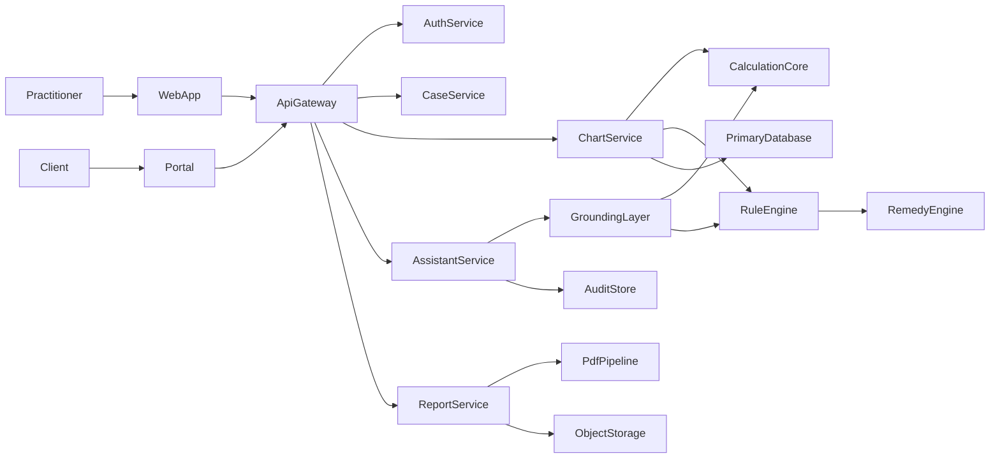

# Enterprise Astrology Platform Docs

## Purpose
This directory is the implementation blueprint for a practitioner-first, enterprise-grade astrology platform. The platform is designed to deliver deterministic astrological computation, explainable predictions, grounded AI assistance, and production-ready operational controls.

The first production release implements Vedic astrology deeply. Additional systems such as KP, Jaimini, Nadi, Western astrology, Numerology, and Lal Kitab are introduced later through versioned extension interfaces rather than ad hoc forks.

## Intended Readers
- Product managers defining release scope and compliance posture.
- Backend, frontend, AI, and platform engineers building the system.
- QA, security, and DevOps teams validating production readiness.
- Domain experts reviewing rules, remedies, and interpretive quality.

## Core Principles
1. Deterministic before generative: astronomical and astrological outputs must come from validated algorithms, ephemeris data, and versioned rule packs.
2. Explainability by default: every prediction, remedy, and recommendation must reference chart facts, timing systems, and rule outcomes.
3. Modular astrology systems: each tradition is implemented as an isolated module behind shared contracts.
4. Practitioner-first workflows: case management, client history, report delivery, and repeat consultations are first-class features.
5. Enterprise governance: auditability, tenant isolation, consent, retention controls, and access control are mandatory architecture concerns.
6. Safe advisory posture: the system may discuss wellness, timing, and spiritual guidance, but it must avoid impersonating regulated medical, legal, or financial advice.

## Release Boundaries
### Version 1
- Deep Vedic/Jyotish support.
- Practitioner and client workspaces.
- Birth chart analysis, dasha analysis, transit analysis, yoga detection, remedies, AI assistant, and PDF reporting.
- Deterministic calculations with explainable AI narratives.
- Regulated-style governance controls from day one.

### Future Versions
- Additional astrology systems via plugin contracts.
- Synastry and compatibility suites.
- Muhurta workflows.
- Multilingual interpretation.
- Marketplace and white-label APIs.

## Start here (product UI)

- [`docs/ui-tour.md`](./ui-tour.md): Live screenshots and a screen-by-screen walkthrough of the practitioner app (demo chart: Ananya Sharma, Varanasi).
- [`docs/getting-started.md`](./getting-started.md): Install, env, run, and troubleshoot locally.
- Root [`README.md`](../README.md): Features, quick start, architecture diagrams, and a condensed product tour gallery.

## Document Map
- `docs/ui-tour.md`: Annotated UI screenshots for onboarding practitioners and contributors.
- `docs/getting-started.md`: Local install and runbook.
- `docs/prd.md`: Product scope, user journeys, success metrics, and phased delivery.
- `docs/system-design.md`: End-to-end system context, runtime flows, and infrastructure interactions.
- `docs/software-architecture.md`: Module boundaries, extension model, and cross-cutting capabilities.
- `docs/database-schema.md`: Core data model, tenancy, audit, and versioned artifacts.
- `docs/astrology-calculation-engine.md`: Deterministic astrology computation strategy.
- `docs/rule-engine-design.md`: Rule representation for yogas, doshas, predictions, and remedies.
- `docs/ai-architecture.md`: Grounded LLM design, tool contracts, and evaluation loops.
- `docs/folder-structure.md`: Proposed monorepo and package layout.
- `docs/api-specification.md`: External and internal APIs, auth scopes, async jobs, and events.
- `docs/frontend-architecture.md`: Practitioner UI, state boundaries, and UX architecture.
- `docs/backend-architecture.md`: Services, jobs, queues, storage, and integration contracts.
- `docs/development-roadmap.md`: Delivery phases and milestones.
- `docs/testing-strategy.md`: Validation strategy across domain logic, AI, APIs, and reports.
- `docs/deployment-strategy.md`: Environment promotion, rollout, recovery, and scaling.
- `docs/security-considerations.md`: Security, privacy, audit, and governance controls.
- `docs/future-enhancements.md`: Planned module expansion and platform evolution.

## Glossary
- `Chart Artifact`: A versioned, immutable computed representation of a birth chart, divisional charts, strengths, and timing states.
- `Interpretation Artifact`: A grounded narrative object generated from computed chart data, rule outputs, and retrieval context.
- `Rule Pack`: A versioned collection of yoga, dosha, prediction, and remedy rules for a specific astrology system.
- `Module`: A pluggable implementation of one astrological tradition that conforms to shared interfaces.
- `Confidence Semantics`: Structured confidence based on rule coverage, signal agreement, and data quality, not model self-confidence.
- `Case Workspace`: A practitioner-owned container for clients, charts, conversations, reports, and follow-up actions.

## Architecture Overview

## Cross-Cutting Requirements
- All major outputs must be versioned and reproducible.
- Long-running work such as full chart generation, AI interpretations, and PDF rendering must run asynchronously.
- Sensitive operations must emit audit events.
- The system must support future tenant-level customization without sacrificing deterministic core behavior.
- Domain logic must be testable independently of the AI layer.

## Decision Log Seeds
Track architecture decisions in future ADRs as the implementation starts. Initial decisions already locked:
- Monorepo architecture.
- Deterministic calculation core separated from narrative AI.
- Practitioner-first product model.
- Vedic-first implementation with modular expansion points.
- Enterprise governance posture from the first release.
