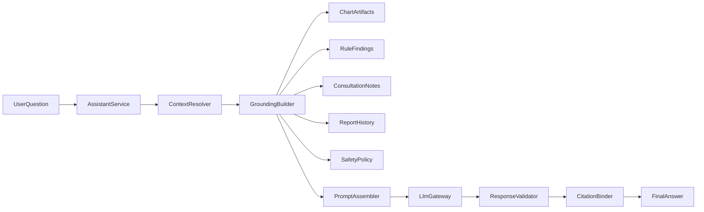

# AI Architecture

## Role Of AI
The AI layer is responsible for explanation, conversation, summarization, and narrative adaptation. It must not invent deterministic chart facts or override the rule engine.

## AI Responsibilities
- answer chart-related user questions
- summarize complex chart and timing patterns
- generate practitioner and client-friendly narratives
- assemble consultation briefs
- assist with report section drafting from grounded data

## Non-Responsibilities
- calculating planets, houses, dashas, yogas, or strengths
- making unsupported predictions outside grounded evidence
- silently suppressing safety warnings or contradictions

## Grounding Model

## Prompt Contract
Every LLM request should include:
- user question
- role and audience context
- selected chart facts
- selected findings and timing states
- contradictory signals when present
- explicit refusal policy
- required citation slots
- output schema

Prefer structured generation first, then optional rendering into prose.

## Retrieval Inputs
- current chart artifact
- selected divisional charts
- active dasha periods
- relevant transit overlays
- yoga and dosha findings
- remedy recommendations
- prior consultation summaries
- workspace policy and disclaimers

## Grounded Answer Requirements
- answer only from retrieved evidence
- cite major claims
- state uncertainty explicitly
- include safe framing for sensitive subjects
- refuse when grounding is insufficient

## Model Strategy
- Primary LLM via configurable provider gateway.
- Optional local or self-hosted models for draft summaries and internal tooling.
- Keep provider choice abstract so Ollama, hosted APIs, or future enterprise providers can be swapped without rewriting orchestration logic.

## Safety Controls
- input filtering for prompt injection attempts in uploaded notes or user questions
- policy checks for harmful, manipulative, or overly certain language
- special handling for health, legal, financial, fertility, and crisis-related questions
- remedy caution overlays for gemstones, rituals, and spending-heavy actions

## Response Validation
Post-generation validation should verify:
- required schema fields present
- citations point to real artifacts
- no unsupported entities introduced
- no disallowed certainty statements
- no contradictions with safety policy

If validation fails, retry with a constrained repair prompt or return a safe fallback summary.

## Conversation Memory
Store thread state separately from deterministic artifacts.
Persist:
- user messages
- assistant messages
- citation references
- safety flags
- summarized context windows

Do not persist raw hidden prompts in user-visible storage.

## Evaluation Loop
- groundedness score
- citation accuracy
- refusal correctness
- practitioner usefulness
- unsafe remedy rate
- hallucination rate

Use offline evaluation sets based on curated charts and practitioner-reviewed questions.

## Report Generation Integration
AI-generated text for reports should come from pre-approved section prompts that consume specific artifacts and produce structured section content. Final report assembly should still preserve citations internally even if the PDF hides them from clients.

## Future Expansion
- multilingual explanation generation
- personalized style presets by practitioner
- comparison conversations for synastry and muhurta
- hybrid retrieval over classical source texts and proprietary rule notes
