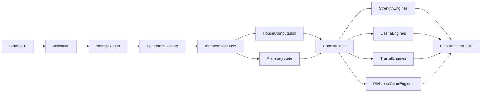

# Astrology Calculation Engine

## Purpose
Provide deterministic, reproducible astrological computation for the platform. This engine is the single source of truth for chart math, timing systems, planetary conditions, and all low-level facts consumed by rules, reports, and AI.

## Design Rules
- No LLM may generate or alter calculated chart facts.
- Inputs, formulas, and source data versions must be recorded for every computed artifact.
- The engine must expose stable typed outputs regardless of internal implementation details.

## Input Contract
- birth date
- birth time
- timezone identifier
- latitude and longitude
- place label
- original location query text and canonical resolved location metadata when coordinates were derived from a user-provided place
- astrology system key
- requested output set
- optional rectification metadata

## Computation Pipeline

## Major Calculation Domains
### Base Astronomical Computation
- Julian day conversion.
- Sidereal calculations with configured ayanamsha.
- Planetary longitudes and motion states.
- House cusp and lagna calculations.
- Node handling, retrograde state, combustion, and dignity status.

### Birth Chart Facts
- lagna and ascendant
- rashi, moon sign, sun sign
- nakshatra and pada
- tithi, yoga, karana, hora
- house occupation and house lordship
- conjunctions and aspects
- bhava chalit variant data

### Divisional Charts
Support D1 first-class and progressively deliver D2 through D60 where mathematically valid and product-approved. Each divisional engine must expose:
- chart identifier
- sign and house placements
- house lords
- dignity shifts
- derived strengths where applicable

### Strength Engines
- shadbala
- ishta/kashta bala
- vimshopaka bala
- ashtakavarga and sarvashtakavarga
- house strength aggregates

### Dasha Engines
Version 1 should support:
- Vimshottari
- Mahadasha to Sookshma nesting
- Yogini
- Ashtottari
- Kalachakra
- Chara dasha where rule pack support exists

Each engine should produce structured sequences with start, end, parent relation, planet key, and computed context summary.

### Transit Engines
- current transit snapshot
- future transit timeline windows
- Saturn, Jupiter, Rahu, and Ketu emphasis summaries
- natal overlay calculation
- retrograde event markers

## Output Model
The engine returns a `ChartArtifactBundle` containing:
- `baseChart`
- `divisionalCharts`
- `planetStates`
- `houseStates`
- `strengthMetrics`
- `dashaSequences`
- `transitSnapshots`
- `calculationMetadata`

## Validation Strategy
- Golden test charts from trusted references.
- Cross-tool comparison against established astrology libraries where licensing allows.
- Tolerance thresholds for astronomical values.
- Snapshot tests for derived structures such as divisional charts and dasha timelines.

## Library Strategy
Use proven astronomical libraries for ephemeris and planetary math where reliable, but wrap them behind adapters so provider replacement is possible. All domain-specific interpretation remains inside platform-controlled packages.

## Extensibility
Each astrology system should register:
- ephemeris and coordinate assumptions
- house and aspect definitions
- divisional chart logic
- timing system engines
- dignity and strength calculators

The Vedic implementation is the reference module for the shared interface.

## Performance Strategy
- Cache intermediate astronomical calculations by normalized birth input hash.
- Precompute reusable transit windows.
- Avoid recomputing unchanged artifacts when only report or interpretation layers change.

## Failure Modes
- Unknown timezone or invalid coordinates.
- Place resolution ambiguity or low-confidence geocoding result.
- Unsupported rectification state for advanced outputs.
- Missing ephemeris data.
- Calculation mismatch against validation thresholds.

Failures should return structured errors and block downstream interpretive generation until resolved.
