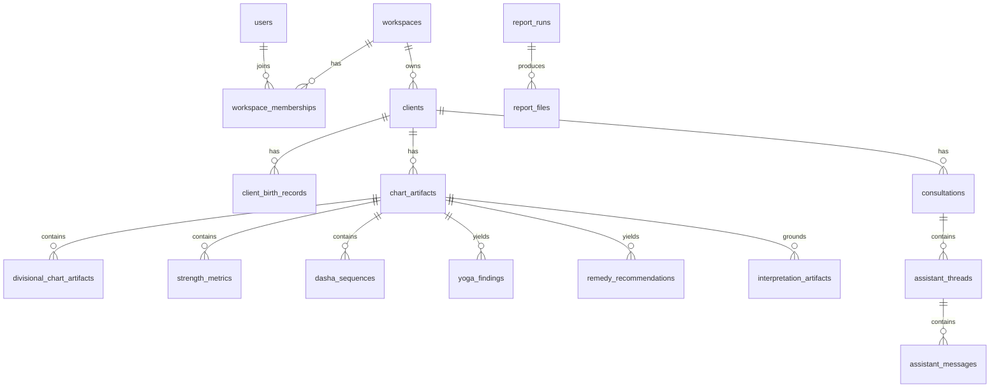

# Database Schema

## Storage Strategy
Use a primary relational database for transactional data and metadata, plus object storage for large generated artifacts such as PDFs, chart snapshots, and exported datasets.

## Core Entity Groups
### Identity And Workspace
- `users`
- `workspaces`
- `workspace_memberships`
- `roles`
- `permissions`
- `user_consents`
- `api_tokens`

### Client And Case Management
- `clients`
- `client_birth_records`
- `consultations`
- `consultation_notes`
- `attachments`
- `tags`
- `client_tag_links`

### Astrology Artifacts
- `chart_requests`
- `chart_artifacts`
- `divisional_chart_artifacts`
- `planet_positions`
- `house_positions`
- `strength_metrics`
- `dasha_sequences`
- `transit_snapshots`
- `yoga_findings`
- `dosha_findings`
- `remedy_recommendations`

### AI And Reporting
- `assistant_threads`
- `assistant_messages`
- `grounding_artifacts`
- `interpretation_artifacts`
- `report_templates`
- `report_runs`
- `report_files`

### Governance And Operations
- `audit_events`
- `retention_policies`
- `deletion_requests`
- `job_runs`
- `webhook_deliveries`
- `notification_events`

## Multi-Tenant Keys
Nearly every tenant-scoped table carries:
- `workspace_id`
- `created_at`
- `updated_at`
- `created_by`
- `version`

All reads and writes must be filtered by workspace boundary except for global configuration tables.

## High-Value Tables
### `clients`
- `id`
- `workspace_id`
- `external_reference`
- `full_name`
- `preferred_name`
- `email`
- `phone`
- `locale`
- `timezone`
- `notes_summary`
- `status`

### `client_birth_records`
- `id`
- `client_id`
- `source`
- `birth_date`
- `birth_time`
- `timezone_name`
- `latitude`
- `longitude`
- `place_label`
- `location_query_text`
- `canonical_location_name`
- `geocode_provider`
- `provider_place_id`
- `geocode_confidence`
- `resolution_method`
- `accuracy_level`
- `rectification_status`
- `is_active`

Store both the original user-entered location text and the canonical resolved location so later recalculation and audit can reproduce how coordinates were obtained.

### `chart_artifacts`
- `id`
- `workspace_id`
- `client_id`
- `birth_record_id`
- `astrology_system`
- `engine_version`
- `ephemeris_version`
- `artifact_hash`
- `ayanamsha`
- `chart_type`
- `payload_json`
- `computed_at`

`payload_json` stores immutable normalized outputs such as lagna, planetary longitudes, dignities, panchang values, and derived chart metadata.

### `strength_metrics`
- `id`
- `chart_artifact_id`
- `metric_family`
- `subject_type`
- `subject_key`
- `metric_name`
- `metric_value`
- `metric_unit`
- `explanation_json`

### `dasha_sequences`
- `id`
- `chart_artifact_id`
- `system_name`
- `level_name`
- `planet_key`
- `starts_at`
- `ends_at`
- `parent_sequence_id`
- `result_payload_json`

### `yoga_findings`
- `id`
- `chart_artifact_id`
- `rule_pack_version`
- `yoga_code`
- `status`
- `strength_score`
- `confidence_score`
- `activation_window_json`
- `evidence_json`

### `remedy_recommendations`
- `id`
- `chart_artifact_id`
- `finding_id`
- `remedy_type`
- `remedy_code`
- `recommendation_strength`
- `contraindications_json`
- `evidence_json`
- `review_status`

### `interpretation_artifacts`
- `id`
- `workspace_id`
- `client_id`
- `chart_artifact_id`
- `grounding_artifact_id`
- `prompt_contract_version`
- `llm_provider`
- `model_name`
- `content_json`
- `safety_flags_json`
- `created_at`

## ERD Overview

## JSON Boundaries
Use JSON columns for:
- deeply nested chart facts
- evidence lists
- model safety metadata
- activation windows
- report section configuration

Keep query-heavy filters in first-class columns, not embedded JSON.

## Audit Model
`audit_events` should capture:
- actor identity
- workspace
- target entity type and id
- action type
- previous value hash when applicable
- request id
- ip address and user agent
- timestamp

## Retention Model
- Keep deterministic chart artifacts indefinitely by default unless the tenant policy says otherwise.
- Conversation artifacts and report files follow workspace retention policies.
- Deletion requests create tombstone records and background purge jobs.

## Indexing Guidance
- compound index on `(workspace_id, client_id)`
- unique index on artifact hash per engine version
- time-range indexes for dasha and transit lookup
- GIN or JSON indexes only for evidence fields that need selective filtering

## Migration Principles
- All schema changes must be forward-compatible.
- Artifact schemas should use explicit version numbers inside JSON payloads.
- Historical reports must continue to resolve old artifact versions even after engine upgrades.
