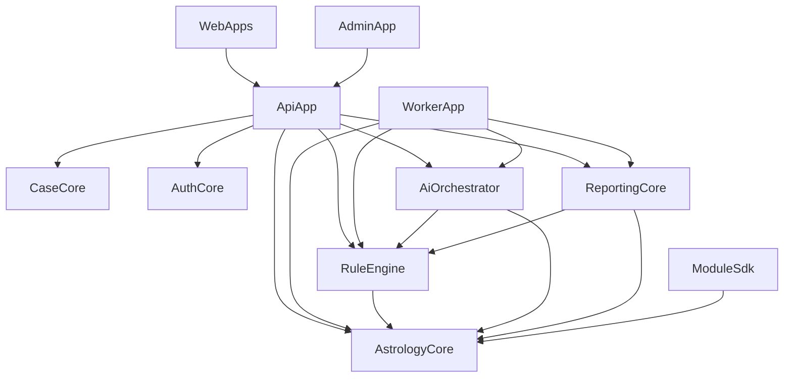

# Software Architecture

## Architectural Style
Use a modular monorepo with domain-oriented packages and service applications. The system should favor clear contracts between deterministic engines, interpretation services, and user-facing applications.

## Top-Level Modules
### Applications
- `web-practitioner`: primary practitioner experience.
- `web-client-portal`: report access and client self-service.
- `api`: authenticated API surface for UI and external integrations.
- `worker`: async processing for charts, reports, notifications, and AI tasks.
- `admin-console`: governance and workspace administration.

### Domain Packages
- `astrology-core`: deterministic astronomy and astrological calculations.
- `rule-engine`: yoga, dosha, timing, scoring, and remedy logic.
- `ai-orchestrator`: grounding, prompt assembly, guardrails, and output validation.
- `reporting-core`: report section assembly, chart visuals, and PDF composition.
- `case-core`: client profiles, notes, timeline items, and consultation workflow.
- `auth-core`: roles, permissions, consent, and policy enforcement.
- `analytics-core`: events, metrics aggregation, and product telemetry.
- `notifications-core`: channels, templates, schedules, and delivery state.
- `module-sdk`: contracts for future astrology systems and rule packs.

## Dependency Direction

Rules:
- `astrology-core` has no dependency on AI packages.
- `rule-engine` depends only on deterministic core contracts and versioned metadata.
- UI packages never access the database directly.
- `module-sdk` defines interfaces but not product policy.

## Module Responsibilities
### `astrology-core`
- Birth chart, divisional charts, shadbala, ashtakavarga, dignities, panchang, dashas, and transits.
- Input normalization and ephemeris adapters.
- Immutable chart artifacts and typed outputs.

### `rule-engine`
- Evaluate yogas, doshas, event signatures, strengths, remedies, and confidence semantics.
- Convert low-level chart facts into explainable findings.
- Manage rule pack versioning and conflict resolution.

### `ai-orchestrator`
- Build evidence bundles from chart artifacts and rule outputs.
- Route safe prompts to the configured LLM backend.
- Validate grounded responses and attach citations.
- Enforce refusal policy for unsupported or unsafe requests.

### `reporting-core`
- Map deterministic and narrative artifacts into report sections.
- Coordinate HTML or component-based render trees for PDF generation.
- Manage templates, branding, and localized content later.

### `case-core`
- Client records, birth input history, practitioner notes, tags, attachments, appointments, and report issuance history.

### `auth-core`
- User lifecycle, memberships, roles, permissions, consent, API tokens, and privileged action policy.

## Plugin Architecture For Future Systems
Each astrology system must implement:
- data model extension definitions
- calculation interfaces
- rule pack registration
- taxonomy mappings for houses, points, aspects, and timing systems
- presentation metadata for UI and reports

Shared contracts should include:
- `SystemDefinition`
- `CalculationProvider`
- `RulePackProvider`
- `InterpretationVocabulary`
- `CompatibilityProvider`

## Versioning Strategy
Version the following independently:
- calculation engine version
- ephemeris data version
- rule pack version
- remedy guidance version
- interpretation prompt contract version
- report template version

This enables re-running historical analyses exactly as originally produced.

## Explainability Architecture
Outputs must be layered:
1. Raw facts: longitudes, houses, dignities, strengths, timings.
2. Findings: yogas, doshas, signal summaries, activation windows.
3. Interpretations: domain narratives, risks, opportunities, and remedies.
4. Presentations: assistant replies, reports, dashboards, and notifications.

Each higher layer must reference the identifiers of the lower layers it used.

## Data Ownership
- `case-core` owns client and consultation lifecycle data.
- `astrology-core` owns computed chart artifacts.
- `rule-engine` owns findings and remedy candidates.
- `ai-orchestrator` owns conversation turns and grounded answer artifacts.
- `reporting-core` owns report manifests and generated files.

## Security Boundaries
- PII handling belongs to application services and storage layers, not domain math packages.
- Secrets for LLMs, PDF rendering, and notifications must be injected through platform configuration only.
- Every write to report delivery, client data export, and privileged admin actions must produce audit events.

## Evolution Guidelines
- Prefer additive contracts over breaking ones.
- Add new astrology systems through module registration, not conditionals spread across services.
- Keep chart calculation APIs stable and expose new details through versioned optional fields.
- Use feature flags for partial rollout of advanced rule packs or AI capabilities.
