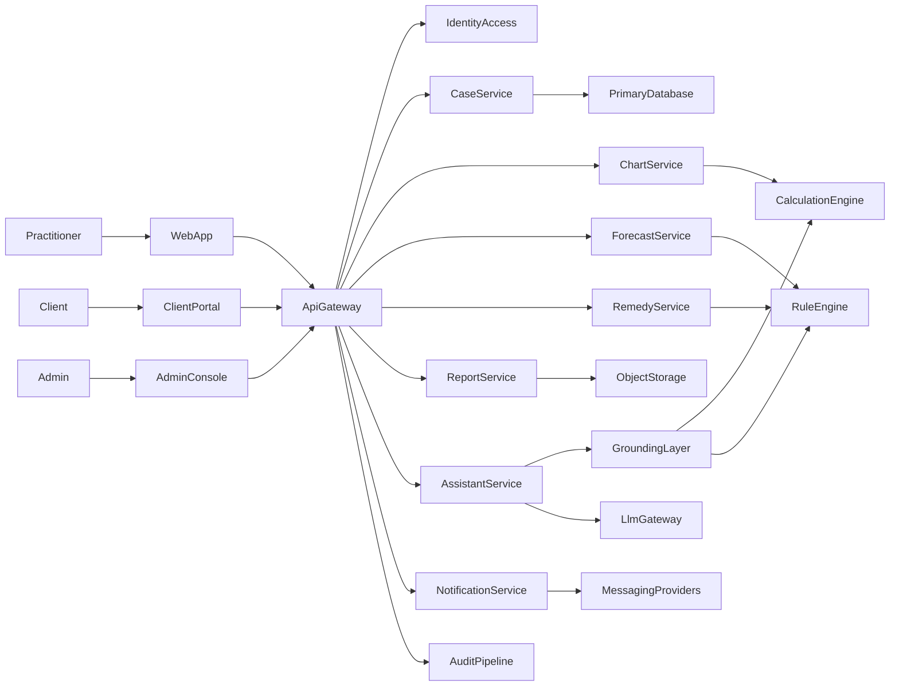

# System Design

## Objective
Design a production-ready, multi-tenant astrology platform where deterministic chart computation is cleanly separated from interpretation, reporting, workflow, and AI interaction layers.

## System Context

## Runtime Domains
### Experience Layer
- Practitioner web application.
- Client portal for report access and guided follow-up.
- Admin console for governance, user management, and workspace controls.

### Application Layer
- API gateway handling auth, rate limiting, request orchestration, and API versioning.
- Domain services for cases, charts, forecasts, remedies, reports, assistant conversations, and notifications.

### Domain Engine Layer
- Deterministic calculation engine for chart math and astronomy.
- Rule engine for yogas, doshas, timing interpretations, confidence scoring, and remedies.
- Grounding layer that transforms computed artifacts into retrieval-ready evidence packs.

### Platform Layer
- Identity provider integration.
- Relational primary database.
- Object storage for PDFs and exported chart artifacts.
- Queue and worker infrastructure for async jobs.
- Geocoding and timezone-resolution provider for birth-place normalization.
- Audit pipeline and observability stack.

## Core Workflows
### Client Intake To First Chart
1. Practitioner creates or imports a client record.
2. Birth location text is resolved into canonical place, latitude, longitude, and timezone, with user confirmation when matches are ambiguous.
3. Birth details are validated and normalized.
4. Chart generation job is queued.
5. Calculation engine produces immutable chart artifacts.
6. Rule engine evaluates yogas, doshas, timing states, and remedy candidates.
7. Artifacts are stored with version metadata.
8. Practitioner reviews structured outputs in the UI.

### Practitioner Question To Grounded Answer
1. User asks a question in the assistant workspace.
2. Assistant service resolves authorization and workspace context.
3. Grounding layer fetches relevant chart facts, timing periods, rules, prior notes, and report excerpts.
4. LLM prompt is assembled with strict contracts and citation slots.
5. Generated answer is validated against grounded evidence.
6. Conversation turn, evidence references, and safety checks are stored.

### Report Generation
1. Practitioner selects report template and output scope.
2. Report job gathers chart artifacts, rule outputs, interpretation artifacts, and visuals.
3. PDF pipeline renders a branded document asynchronously.
4. Signed delivery links are issued to the practitioner or client portal.

## Bounded Contexts
- `IdentityAccess`: users, roles, sessions, workspace memberships, and consent.
- `CaseManagement`: client profile, birth details, consultation history, notes, and tags.
- `AstrologyCore`: chart computations, ephemeris access, divisional charts, strengths, and timing systems.
- `Interpretation`: rule evaluation, prediction generation, remedies, and explainability objects.
- `Assistant`: chat orchestration, retrieval grounding, safety policy, and answer provenance.
- `Reporting`: templates, sections, rendering jobs, branding, and export lifecycle.
- `Notifications`: reminders, report readiness, appointment prompts, and digest preferences.
- `Governance`: audit records, retention policies, data export, deletion, and admin controls.

## Service Interaction Rules
- Deterministic services must never depend on LLM output.
- AI services may consume computed and rule-derived artifacts but cannot write back new deterministic chart facts.
- Cross-service writes should occur through explicit APIs or event contracts, not direct table mutation.
- Every externally visible interpretation must include provenance references to one or more chart or rule artifacts.

## Tenancy Model
- Single application cluster with logical tenant isolation by workspace.
- Shared services, isolated data access by workspace boundary.
- Optional future path for dedicated enterprise tenants through workspace-level encryption domains and isolated worker pools.

## Async Job Model
Use a queue-backed worker model for:
- full chart generation
- bulk forecast refresh
- PDF rendering
- scheduled notifications
- assistant summary generation
- analytics aggregation

Jobs must be idempotent, retry-safe, and emit structured status events.

## Failure Handling
- Invalid or ambiguous birth data should fail fast with structured correction guidance.
- Unknown, low-confidence, or ambiguous birth-place matches must request manual confirmation before chart computation proceeds.
- Partial deterministic failures must prevent downstream AI interpretation.
- LLM unavailability should degrade gracefully to structured deterministic summaries where possible.
- Report render failures should preserve job state and support operator retry.

## Observability
- Distributed tracing across API, workers, and LLM calls.
- Domain metrics: chart generation latency, rule pack coverage, grounded answer rate, unsafe answer rate, report generation time.
- Structured audit events for access to sensitive records, export generation, and administrative actions.

## Scalability Notes
- Calculation workers scale horizontally by queued chart jobs.
- Report rendering and AI conversation workloads should run in separate worker pools.
- Hot chart artifacts and rule evaluation summaries should be cached per versioned input hash.

## Design Constraints
- Deterministic engines must be reproducible and version pinned.
- All critical chart outputs must be storable as immutable artifacts.
- Every generated answer or report section must be linked to supporting evidence.
- Architecture must anticipate additional astrology systems without changing application-layer contracts.
