# UI tour — practitioner workspace

Live screenshots from a real chart for **Ananya Sharma**, born **15 March 1995, 06:42** in **Varanasi, Uttar Pradesh, India** (Asia/Kolkata). Lagna: **Pisces 10°32′** · Moon nakshatra: **Magha pada 2** · Ayanamsa: **Lahiri**.

Use this page to understand what each screen does before you run the stack locally ([getting started](./getting-started.md)).

> Guidance in the product is advisory only — not medical, legal, or financial advice.

---

## Demo client used in these shots

| Field | Value |
|-------|--------|
| Full name | Ananya Sharma |
| Preferred name | Ananya |
| Email | ananya.sharma@example.com |
| Phone | +91 98765 43210 |
| Birth date | 1995-03-15 |
| Birth time | 06:42 |
| Place | Varanasi, Uttar Pradesh, India |
| Timezone | Asia/Kolkata |
| Coordinates | 25.3176° N, 82.9739° E |

Recreate the same intake in **New client chart**, or open any completed chart from **Clients**.

---

## 1. Dashboard

**Route:** `/`

The home workspace for the practice day: live panchang strip, KPI tiles, recent clients, and upcoming sky events.

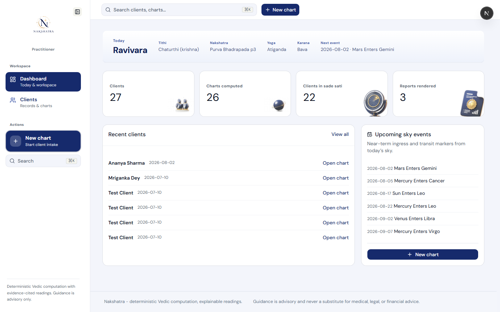

**What to look for**

- **Today strip** — vara, tithi, nakshatra, yoga, karana, and the next transit/ingress
- **KPIs** — clients, charts computed, clients in sade sati, reports rendered
- **Recent clients** — jump straight to a chart (Ananya appears at the top after intake)
- **Upcoming sky events** — short horizon of planetary sign changes

**Typical flow:** glance at today → open a recent client → or click **New chart**.

---

## 2. Clients board

**Route:** `/clients`

All client records in the workspace. Search from the top bar or `⌘K` / `Ctrl+K`.

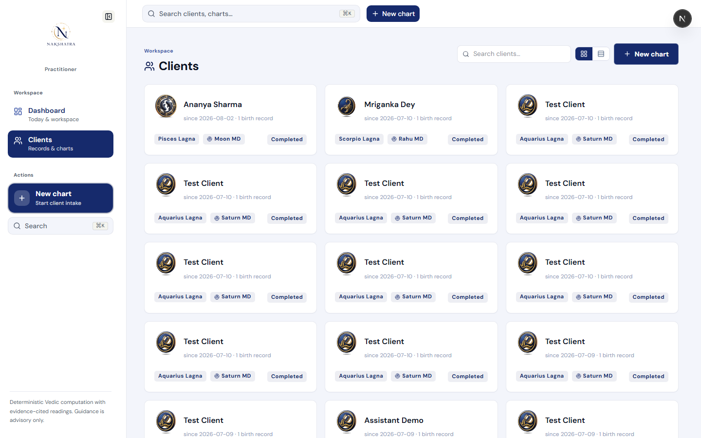

**What to look for**

- Client cards with name, lagna hint, and latest chart status
- Entry point to intake via **New chart**
- Open a person to see birth records and chart history

---

## 3. New client intake

**Route:** `/clients/new`

Three-step ledger intake: identity → birth moment → place, then **Generate chart**.

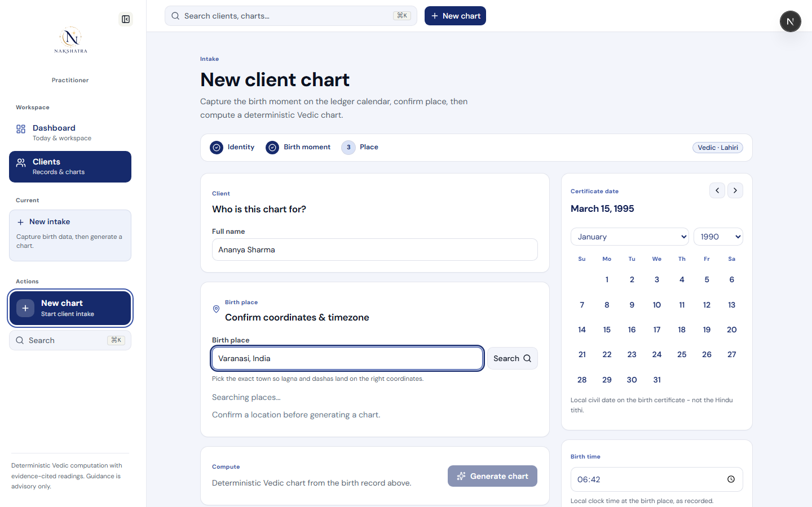

**What to look for**

- **Full name** and calendar date (civil certificate date, not Hindu tithi)
- **Birth time** as local clock time at the birth place
- **Birth place** search → confirm coordinates and timezone before compute
- System badge: **Vedic · Lahiri**

Until a location is confirmed, **Generate chart** stays disabled so the engine never runs on ambiguous coordinates.

---

## 4. Client detail

**Route:** `/clients/[clientId]`

One person’s file: contact fields, birth records, and completed chart jobs.

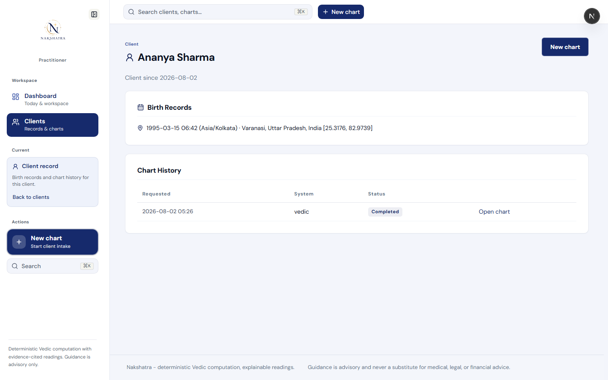

**What to look for**

- Preferred name, email, phone when stored
- Birth record with place and timezone
- Links into each completed **Birth Chart** job

---

## 5. Chart overview

**Route:** `/charts/[jobId]` · tab **Overview**

Immutable Vedic artifact for the birth moment: D1 kundali, lagna line, and birth panchang.

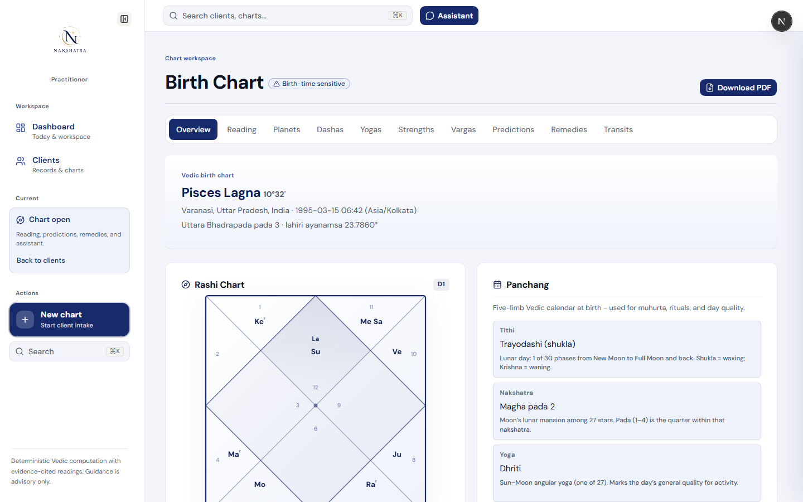

**What to look for**

- Header: lagna, place, civil datetime, Moon pada, ayanamsa
- **Birth-time sensitive** badge when placements sit near sign/nakshatra/pada boundaries
- North Indian **D1** diamond with graha abbreviations
- Birth **Panchang** cards (tithi, nakshatra, yoga, …)
- **Download PDF** for the branded report

---

## 6. Planets

**Tab:** **Planets**

Sidereal longitudes, signs, houses, nakshatras, dignity, and condition flags.

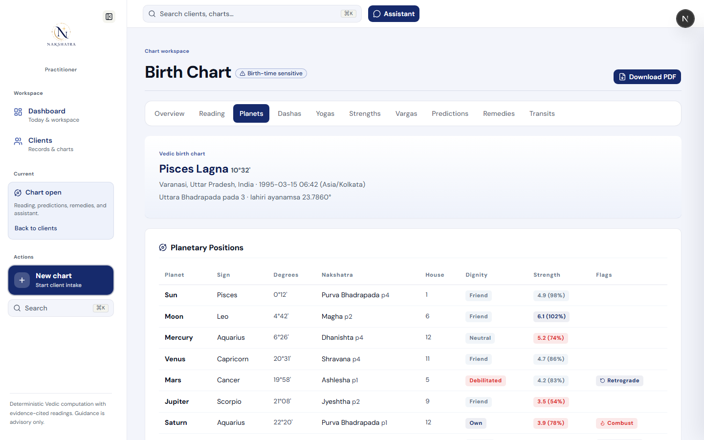

Use this tab when you need exact degrees or to verify dignity/combustion/retrograde before a reading.

---

## 7. Dashas

**Tab:** **Dashas**

Vimshottari (and Yogini when selected) timelines for mahadasha / antardasha structure.

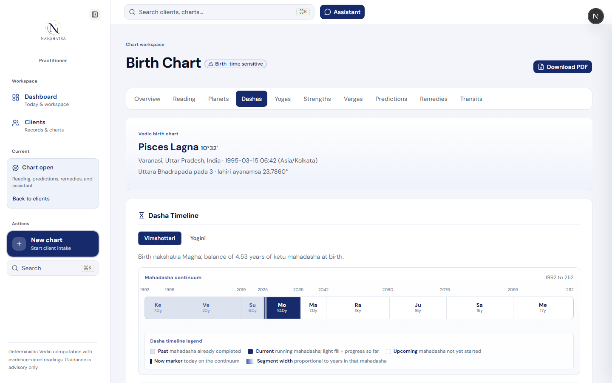

Dated prediction windows and **Your Life** chapters are built on these periods.

---

## 8. Yogas

**Tab:** **Yogas**

Detected yogas and doshas with evidence strings pointing back to placements.

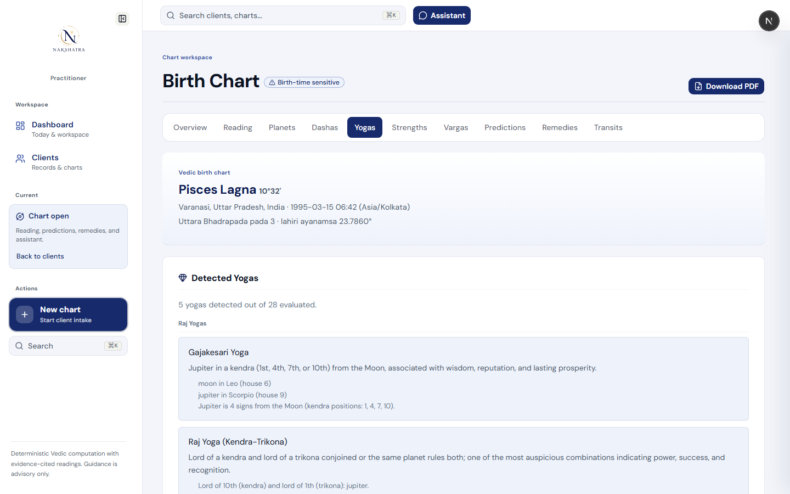

Example signature on this demo chart: **Gajakesari Yoga** (also referenced in the assistant suggestions).

---

## 9. Strengths

**Tab:** **Strengths**

Shadbala, Ashtakavarga / Sarvashtakavarga, and related strength tables.

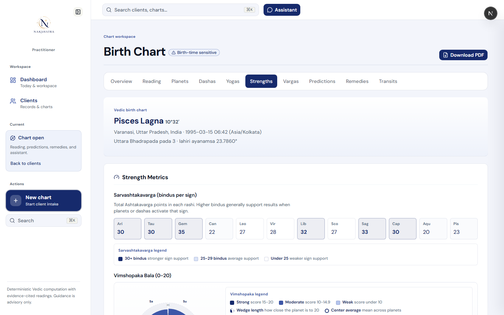

Prediction confidence and remedy eligibility lean on these scores plus house rulerships.

---

## 10. Predictions

**Tab:** **Predictions**

Dated windows from dasha × natal strength × transit rules. Filter by life area.

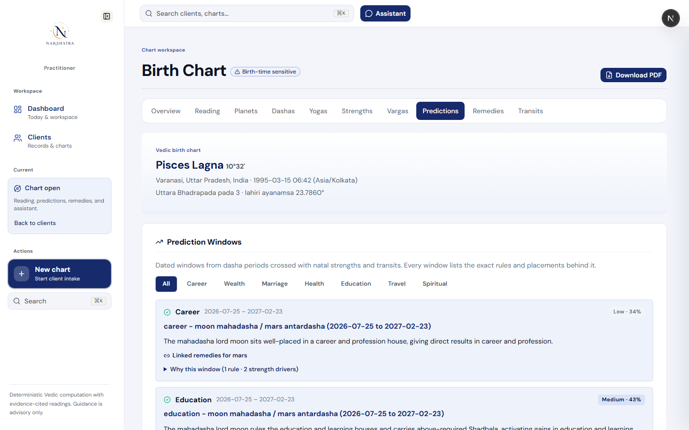

**What to look for**

- Category chips: Career, Wealth, Marriage, Health, Education, …
- Each card: date range, confidence band, short rationale
- Expandable **Why this window** with rule ids and strength drivers
- Links into related remedies

---

## 11. Remedies

**Tab:** **Remedies**

Rule-backed suggestions with cautions (including hard gates such as gemstone eligibility).

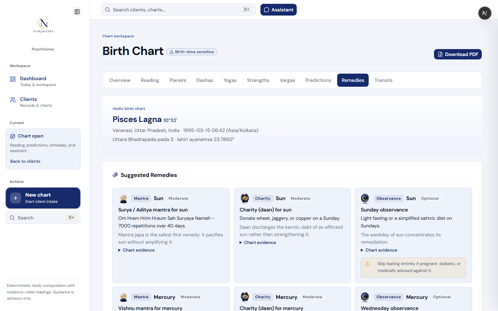

Always read the caution text with the client — the product is advisory, not prescriptive.

---

## 12. Reading · Your Life

**Tab:** **Reading**

Deterministic **Deep reading** plus **Your Life** chapters (hybrid, age-band, and dasha lenses).

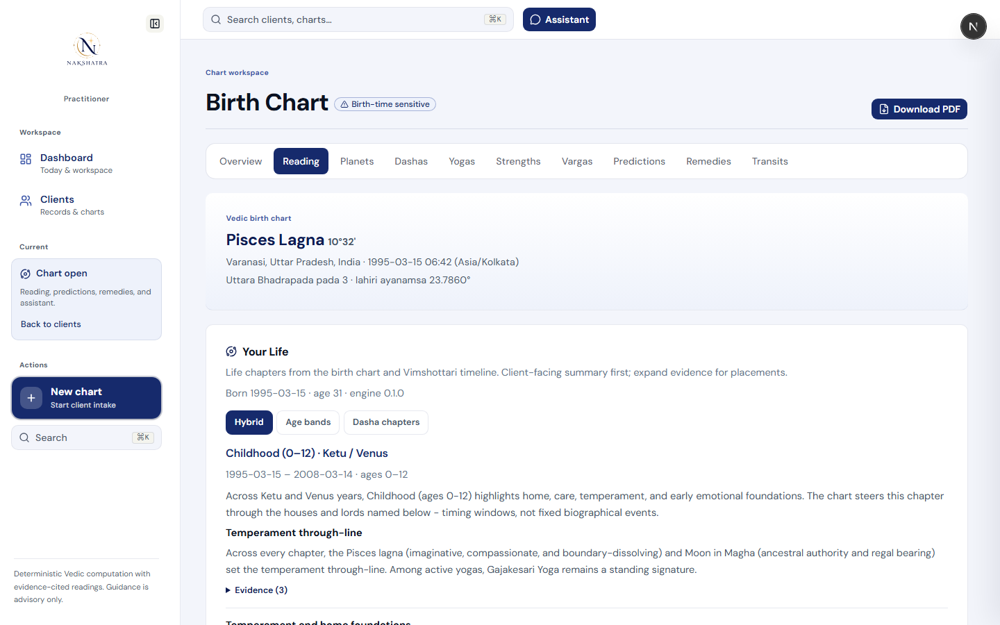

**What to look for**

- **Your Life** with Hybrid / Age bands / Dasha chapters
- Chapter titles tied to dasha lords (e.g. Childhood · Ketu / Venus)
- Expandable **Evidence** under each narrative block
- Engine version and generated timestamp

Requires the Python reading venv (`services/api-py`). See [getting started](./getting-started.md).

---

## 13. Chart assistant

**Deep link:** `/charts/[jobId]?assistant=open`

Per-chart AI dock. Memory does not bleed across charts. Answers are expected to cite tool facts.

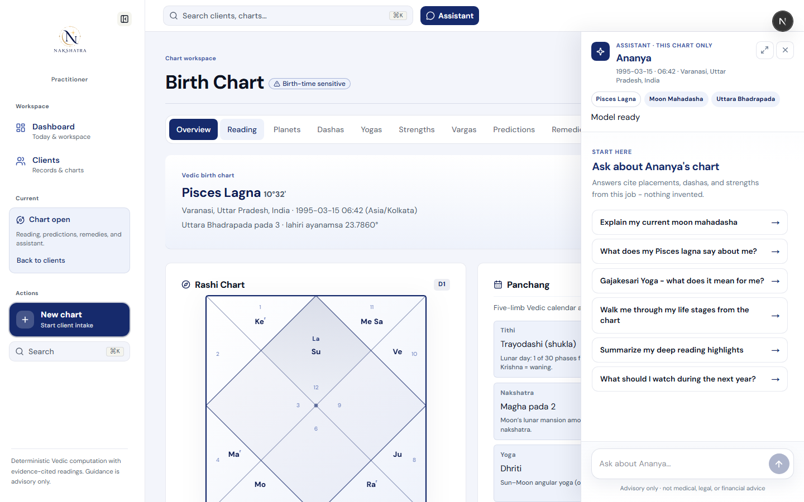

**What to look for**

- Context chips (lagna, current mahadasha, Moon pada)
- Suggested questions personalized to this chart
- Citation chips in answers jump to planets / dashas / transits in the main pane
- Health banner when the model is offline or in mock mode

Toggle from the top **Assistant** button, or open with `?assistant=open`.

---

## 14. Print / PDF report

**Route:** `/charts/[jobId]/print`

Printable layout used by Playwright to render the branded PDF (logo, kundali, tables, life story, remedies, footer credit).

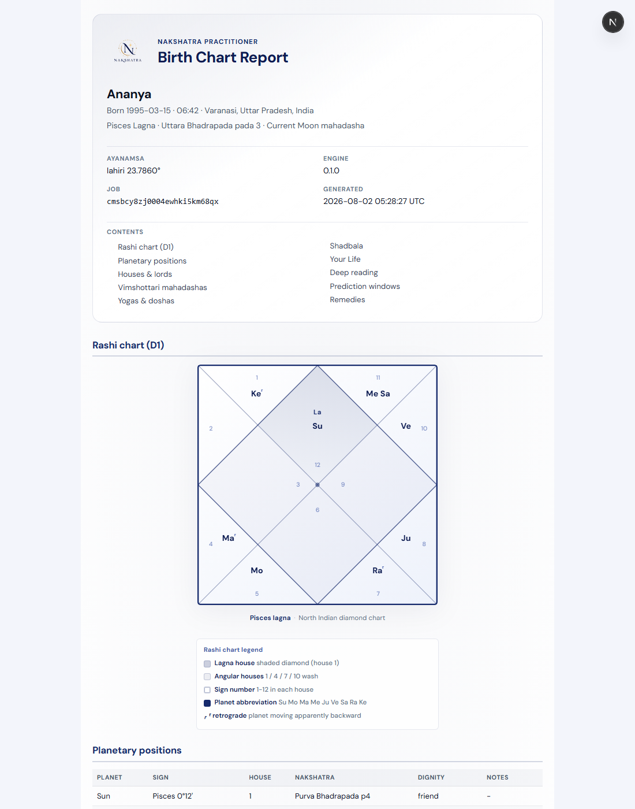

From the chart workspace, use **Download PDF**. Ensure Chromium is installed (`pnpm exec playwright install chromium`) and `WEB_BASE_URL` points at the web app.

---

## 15. Transits

**Tab:** **Transits**

Gochar snapshot, sade sati context, and near-term event timeline relative to the natal chart.

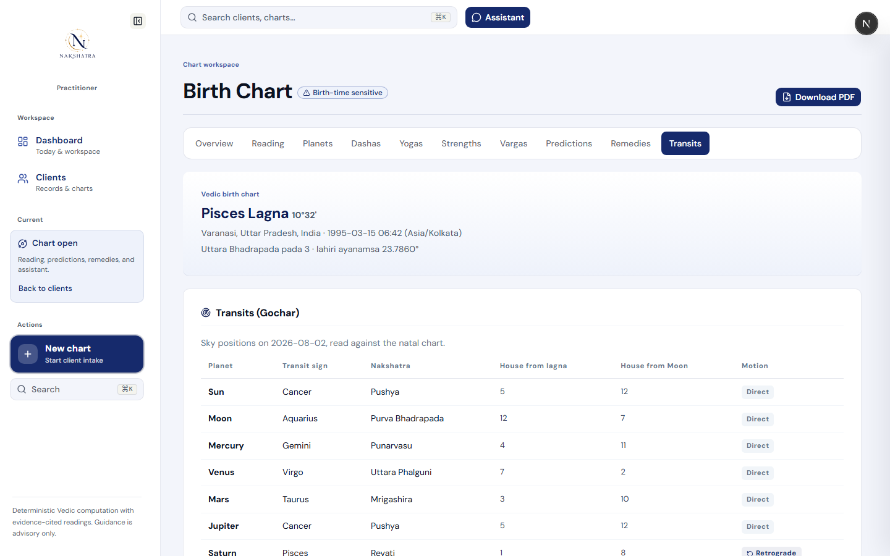

---

## Suggested walkthrough (10 minutes)

1. Open **Dashboard** — read today’s panchang.
2. **New chart** — enter Ananya’s details (or your own) and confirm Varanasi.
3. Wait for the job to complete → open **Overview**.
4. Skim **Planets**, **Dashas**, **Yogas**, **Strengths**.
5. Open **Reading** for Your Life chapters.
6. Filter **Predictions** / **Remedies** for the consultation topic.
7. Open **Assistant** and ask one question; click a citation chip.
8. **Download PDF** and spot-check the print layout.

---

## Regenerating screenshots

With web + API running and a completed job id:

```bash
node tools/capture-ui-screenshots.mjs <jobId> <clientId>
```

Images land in `docs/images/ui/`.
